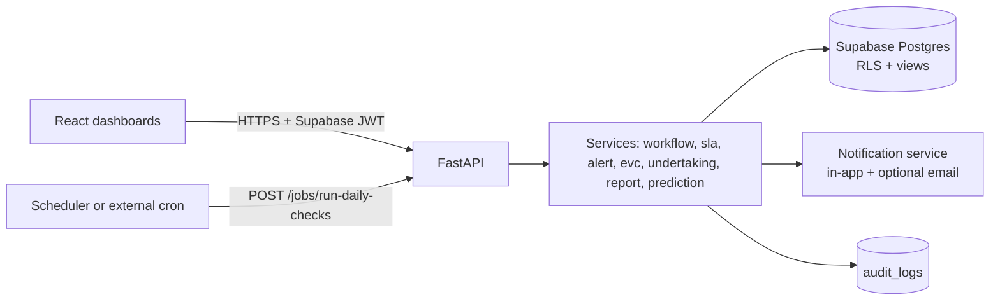

# SIH26262: AICTE Approval Workflow Automation, Compliance Monitoring and Alert Management System

A web platform that moves AICTE approval applications through configurable stages, watches deadlines, schedules Expert Visit Committees (EVC), tracks institutional undertakings and document validity, and raises reminders and escalations automatically.

**Stack:** React · Vite · Tailwind CSS · React Router · Axios · Recharts · FastAPI · Pydantic · SQLAlchemy · Supabase (Postgres + Auth + Storage) · pytest · Vitest

> **Status and assumptions.** This README is derived from `SIH26262_FRONTEND.md` and `SIH26262_BACKEND.md`.
> - This is a **standalone project** with its own Git repository and its own Supabase project. The backend guide's SQL assumed tables and helper functions from SIH26263, so here they are created in `database/migrations/001_foundation.sql`.
> - Only the first part of the problem statement was available (it stops at "A. End-to-End Approval Workflow Automation"). Re-check scope against the full text before submission.
> - Every stage name, SLA number, reminder offset and escalation threshold in this repo is a **placeholder**, stored in config tables. They are not official AICTE values.
> - The SQL has **not yet been executed** on a real Postgres or Supabase instance. Run it in a scratch project first.
> - Use **synthetic data only**. Never add real institution, student or officer data.

---

## Table of Contents

1. [What the system does](#1-what-the-system-does)
2. [Users and roles](#2-users-and-roles)
3. [Architecture](#3-architecture)
4. [Repository structure](#4-repository-structure)
5. [Getting started](#5-getting-started)
6. [Environment variables](#6-environment-variables)
7. [Database](#7-database)
8. [Backend](#8-backend)
9. [Frontend](#9-frontend)
10. [Testing](#10-testing)
11. [Security](#11-security)
12. [Synthetic data and demo](#12-synthetic-data-and-demo)
13. [Build plan](#13-build-plan)
14. [Relationship to SIH26263](#14-relationship-to-sih26263)
15. [Open questions](#15-open-questions)
16. [Git workflow](#16-git-workflow)

---

## 1. What the system does

An application from an institution passes through several stages: scrutiny, re-scrutiny when deficiencies are found, an EVC visit, a regional committee and SAC/SHC, and finally a decision. Some approvals are granted subject to undertakings with deadlines, such as submitting a lease document. Today, tracking all of this is manual and spread across regions and officers.

| Capability | What it gives |
|---|---|
| Workflow automation | Applications move through configurable stages and are routed to the right officer |
| Pendency monitoring | Stage-wise ageing, SLA breaches, region and officer views |
| EVC scheduling | Suggested dates and committees without expert clashes |
| Undertakings and compliance | Time-bound commitments with submit and verify flow |
| Document validity | Lease and similar documents with expiry tracking |
| Alerts and escalation | Reminders before a deadline and widening escalation after it passes |
| Dashboards | Role-based views for officers, regional and national heads, institutions, auditors and admins |
| Audit trail | Every state change is logged |
| Innovation | Delay prediction (ML), bottleneck analytics, smart priority score, document-validity calendar |

**Design principles**

1. Anything that can change in AICTE's process (stages, SLA, owners, reminders, escalation) is **data in tables**, not code.
2. The system is a **tracking and decision-support tool**. It never approves or rejects. Officers record decisions.
3. Every state change is written to the audit log.
4. Colour is never the only signal in the UI, and all dates are shown in IST.

## 2. Users and roles

| User | Role in `profiles` | Landing page | Key question |
|---|---|---|---|
| Section / Scrutiny officer | `aicte_officer` + `SECTION_OFFICER` / `SCRUTINY_OFFICER` | `/officer/dashboard` | What needs my action today? |
| Regional head | `aicte_officer` + `REGIONAL_HEAD` | `/region/dashboard` | Where is my region slow? |
| National head | `aicte_officer` + `NATIONAL_HEAD` | `/national/dashboard` | Where are the national bottlenecks? |
| Institution | `institution_admin`, `institution_staff` | `/institution/dashboard` | Where is my application, what is due? |
| Auditor | `auditor` | `/audit` | Who did what, and when? |
| System admin | `system_admin` | `/admin/workflow` | Can I change stages, SLA and rules without code? |

Permissions are enforced twice: in backend dependencies (`require_roles`, `require_region_access`) and in database Row Level Security. Hiding a menu item in the UI is not security.

## 3. Architecture



- **FastAPI** hosts the API. Services are plain Python modules, so most tests need no database.
- **Supabase Postgres** stores data. SQL views serve dashboards. RLS protects rows.
- **Scheduler:** APScheduler locally. On free hosting the process may sleep, so for the deployed demo use an external cron (GitHub Actions or cron-job.org) that calls `POST /api/v1/jobs/run-daily-checks` with a secret header.
- **Integrations:** AICTE portal data enters through an adapter interface (`integrations/aicte_portal.py`) with a mock implementation.
- **"Real-time" in the prototype means polling** (alerts and KPIs every 60 seconds). Supabase Realtime on the `alerts` table is a later upgrade.

## 4. Repository structure

A standalone monorepo with its own Git repository. File names under `pages/` are suggestions.

```text
sih26262/
├── .github/
│   └── pull_request_template.md
├── docs/
│   ├── requirements.md
│   ├── task-list.md
│   ├── api-contract.md                  # endpoint contracts (backend section 15)
│   ├── database-schema.md
│   ├── demo-script.md
│   ├── SIH26262_BACKEND.md              # backend guide
│   ├── SIH26262_FRONTEND.md             # frontend guide
│   └── screenshots/                     # captured for the presentation
├── database/
│   ├── README.md
│   ├── migrations/
│   │   ├── 001_foundation.sql               # user_role enum, institutions, profiles (role, officer_level, region), audit_logs, set_updated_at(), RLS helper functions, signup trigger
│   │   ├── 002_workflow_config.sql          # workflow_stages + seed stages
│   │   ├── 003_applications.sql             # applications, application_stage_history
│   │   ├── 004_evc.sql                      # experts, expert_unavailability, evc_visits, evc_visit_experts
│   │   ├── 005_undertakings_documents.sql   # undertakings, compliance_documents
│   │   ├── 006_alerts_rules.sql             # alert_rules, escalation_rules, alerts
│   │   └── 007_rls.sql                      # RLS policies for all new tables
│   ├── views/
│   │   └── 008_reports_views.sql            # v_pipeline_funnel, v_pendency_aging, v_sla_breaches, ...
│   └── seed/
│       └── (generated by backend/scripts/seed_262.py)
├── backend/
│   ├── alembic/
│   ├── alembic.ini
│   ├── requirements.txt
│   ├── .env.example
│   ├── models/                          # delay_model.joblib (generated, git-ignored)
│   ├── scripts/
│   │   ├── seed_262.py                  # deterministic synthetic data
│   │   └── train_delay_model.py         # offline ML training
│   └── app/
│       ├── main.py                      # FastAPI app, CORS, routers, scheduler start
│       ├── core/
│       │   ├── config.py                # settings from env
│       │   ├── security.py              # JWT validation, current user
│       │   ├── permissions.py           # require_roles, require_region_access
│       │   ├── exceptions.py            # InvalidTransition, ValidationError
│       │   └── scheduler.py             # APScheduler setup
│       ├── api/v1/
│       │   ├── applications.py          # list, create, detail, move, assign, hold, resume
│       │   ├── workflow.py              # stages, escalation rules, alert rules
│       │   ├── alerts.py
│       │   ├── evc.py                   # suggest, create, confirm, reschedule, complete, cancel, experts
│       │   ├── undertakings.py
│       │   ├── documents.py             # compliance documents and timeline
│       │   ├── reports.py               # KPIs, funnel, aging, bottlenecks, exports
│       │   ├── predictions.py           # at-risk, delay-risk
│       │   ├── jobs.py                  # run-daily-checks
│       │   └── audit.py                 # audit logs
│       ├── models/                      # SQLAlchemy models
│       ├── schemas/                     # Pydantic request and response models
│       ├── services/
│       │   ├── workflow_service.py      # validate_transition, move_application
│       │   ├── sla_service.py           # due dates, reminder_offset, escalation_level
│       │   ├── alert_service.py         # alerts with dedupe, recipients, auto-resolve
│       │   ├── evc_service.py           # suggest_evc, confirm with clash check
│       │   ├── undertaking_service.py   # lifecycle and overdue marking
│       │   ├── document_service.py      # validity status
│       │   ├── priority_service.py      # priority score
│       │   ├── report_service.py        # queries and exports
│       │   ├── prediction_service.py    # load model, predict, fallback
│       │   ├── notification_service.py  # in-app, optional email
│       │   └── audit_service.py         # writes audit_logs rows
│       ├── integrations/
│       │   └── aicte_portal.py          # adapter interface + mock
│       ├── validators/                  # reusable input validators
│       ├── utils/
│       └── tests/                       # pytest
├── frontend/
│   ├── index.html
│   ├── package.json
│   ├── vite.config.js
│   ├── .env.example
│   ├── public/
│   └── src/
│       ├── main.jsx   App.jsx   index.css
│       ├── api/
│       │   ├── axiosClient.js           # base URL, JWT interceptor, 401 handler
│       │   └── supabaseClient.js
│       ├── services/                    # one file per backend area, mock or real
│       │   ├── applicationsService.js   alertsService.js    evcService.js
│       │   ├── undertakingsService.js   documentsService.js reportsService.js
│       │   └── workflowService.js       auditService.js
│       ├── mocks/                       # JSON fixtures that follow the data contracts
│       ├── context/AuthContext.jsx      # session, profile, role helpers
│       ├── hooks/                       # useAuth, useApi, usePolling, useDebounce
│       ├── routes/                      # AppRoutes.jsx, AuthGuard.jsx, roleLanding.js
│       ├── components/
│       │   ├── common/                  # KpiCard, StatusBadge, SlaChip, DataTable, FilterBar, Modal, Toast, Loader, EmptyState, ErrorState
│       │   ├── layout/                  # AppShell, Sidebar, Navbar, AlertBell, PageHeader
│       │   ├── charts/                  # FunnelChart, AgingChart, BottleneckHeatmap, TrendChart
│       │   ├── applications/            # StageTimeline, MoveStageModal, ApplicationTable, PriorityPill, DelayRiskTag
│       │   ├── evc/                     # EvcCalendar, ExpertPicker, SuggestionList
│       │   └── compliance/              # DeadlineList, ExpiryTimeline, UndertakingCard
│       ├── pages/
│       │   ├── auth/                    # Login, Register
│       │   ├── officer/                 # Dashboard, ApplicationsList, ApplicationDetail, Alerts, Evc, Undertakings, Documents
│       │   ├── region/                  # Dashboard
│       │   ├── national/                # Dashboard
│       │   ├── bottlenecks/             # Bottlenecks
│       │   ├── institution/             # Dashboard, ApplicationDetail, Undertakings, Documents
│       │   ├── admin/                   # WorkflowAdmin, EscalationRules, AlertRules, Jobs
│       │   ├── audit/                   # AuditLog
│       │   ├── reports/                 # Reports
│       │   └── errors/                  # Forbidden (403), NotFound (404)
│       └── utils/                       # formatDate (IST), formatDays, severityStyles, download
├── .env.example
├── .gitignore
├── docker-compose.yml
└── README.md
```

## 5. Getting started

**Prerequisites:** Node 20+, Python 3.12+, a new Supabase project dedicated to this app (free tier is enough).

```bash
git clone <repository-url>
cd sih26262
```

**1. Database.** In the Supabase SQL editor run, in this order: `database/migrations/001` to `007`, then `database/views/008_reports_views.sql`, then the seed produced by `backend/scripts/seed_262.py`. Use a scratch project first, because the SQL has not been executed yet.

**2. Backend**

```bash
cd backend
python -m venv venv
source venv/bin/activate          # Windows: venv\Scripts\Activate.ps1
pip install -r requirements.txt
cp .env.example .env              # fill values
uvicorn app.main:app --reload --port 8000
```

Health check: `GET http://localhost:8000/health`.

**3. Frontend**

```bash
cd frontend
npm install
cp .env.example .env.local        # set VITE_USE_MOCKS=true to start without a backend
npm run dev                       # http://localhost:5173
```

Other scripts: `npm run build`, `npm run test`, and in the backend `pytest`.

## 6. Environment variables

**Backend (`backend/.env`, never commit)**

```
SUPABASE_URL=
SUPABASE_JWT_SECRET=
SUPABASE_SERVICE_ROLE_KEY=         # server only
DATABASE_URL=
FRONTEND_ORIGIN=http://localhost:5173
JOB_SECRET=
NOTIFY_EMAIL_ENABLED=false
SMTP_HOST=  SMTP_USER=  SMTP_PASSWORD=
TZ_DISPLAY=Asia/Kolkata
SLA_USE_WORKING_DAYS=false
DOCUMENT_EXPIRING_DAYS=30
REMINDER_OFFSETS=7,3,1
DELAY_MODEL_PATH=models/delay_model.joblib
```

**Frontend (`frontend/.env.local`, never commit)**

```
VITE_API_URL=http://localhost:8000/api/v1
VITE_SUPABASE_URL=
VITE_SUPABASE_ANON_KEY=
VITE_USE_MOCKS=true
VITE_RISK_TAG_THRESHOLD=0.7
```

Only public values go into `VITE_*` variables. The service-role key must never reach the frontend.

## 7. Database

### Tables

| Table | Purpose |
|---|---|
| `institutions`, `profiles`, `audit_logs` | Foundation tables from `001_foundation.sql`. `profiles` carries `role`, `officer_level` and `region`; `audit_logs` is append-only |
| `workflow_stages` | Configuration of the process: order, SLA days, owner role, allowed next stages |
| `applications` | One row per application, current stage, owner, priority score, decision |
| `application_stage_history` | Event log, one row per stage visit (`entered_at`, `due_at`, `exited_at`). Pendency, SLA breaches and bottlenecks are derived from it |
| `experts`, `expert_unavailability` | EVC expert pool and availability |
| `evc_visits`, `evc_visit_experts` | Scheduled visits and committees |
| `undertakings` | Time-bound commitments with status `PENDING`, `SUBMITTED`, `VERIFIED`, `OVERDUE`, `WAIVED` |
| `compliance_documents` | Lease and similar documents with `valid_until` and status `VALID`, `EXPIRING`, `EXPIRED` |
| `alert_rules`, `escalation_rules` | Reminder offsets and the escalation ladder, editable by admin |
| `alerts` | Generated alerts, deduplicated by a unique `dedupe_key` |

Key database rules:

- A partial unique index guarantees **one open stage row per application**.
- Dates are stored in UTC (`timestamptz`) and shown in IST by the frontend.
- Documents are stored in private Supabase Storage buckets. Tables hold only the path.

### Views (dashboards)

`v_pipeline_funnel`, `v_pendency_aging`, `v_sla_breaches`, `v_stage_bottlenecks`, `v_officer_workload`, `v_upcoming_deadlines`, `v_region_summary`. All use `security_invoker = true` so RLS applies to the caller.

### Row Level Security

| Table | Select | Insert / update |
|---|---|---|
| `workflow_stages`, `alert_rules`, `escalation_rules` | all authenticated | `system_admin` |
| `applications` | officers by region, national head and auditors all, institutions own | per permission matrix |
| `application_stage_history`, `alerts` | follows parent or recipient | backend (service role); recipient may acknowledge |
| EVC tables | officers and auditors, institutions read own | regional head, national head, admin |
| `undertakings`, `compliance_documents` | officers by region, institutions own | institution submits own, officers verify |

## 8. Backend

### Workflow engine

1. A move is valid only if `to_stage` is in the current stage's `next_stages`.
2. Moving closes the open history row, opens a new one with `due_at = entered_at + sla_days`, updates the application, recomputes priority and writes an audit log, all in **one transaction**.
3. Moving to a terminal stage requires a `decision`.
4. A move out of scrutiny with outcome `DEFICIENCY_FOUND` increments `deficiency_count`.
5. Owner resolution picks the least-loaded active officer with the stage's owner role.

Placeholder stages: `SUBMITTED → SCRUTINY → RE_SCRUTINY → EVC → REGIONAL_COMMITTEE → SAC_SHC → DECIDED`. Edit them in `workflow_stages`.

### SLA, alerts and escalation

- **Reminder (level 0)** before a due date at configured offsets (placeholder 7, 3, 1 days). The smallest offset already entered is used, so a missed job run still sends the right reminder.
- **Escalation (level 1 to n)** after the due date, to a widening audience.

| Level | After overdue by | Notify (placeholder) |
|---|---|---|
| 1 | 0 days | Owner officer |
| 2 | 4 days | Section head |
| 3 | 8 days | Regional head |
| 4 | 15 days | National head |

- **Deduplication:** `dedupe_key = entity_type:entity_id:rule_code:L<level>` (escalations) or `...:R<offset>` (reminders), inserted with `on conflict do nothing`. Running the daily job twice never duplicates alerts.
- **Daily job** scans open stages, undertakings, documents and EVC visits, updates statuses, creates alerts, recomputes priority and auto-resolves alerts whose cause is gone.
- Channels: in-app (mandatory); email optional behind `NOTIFY_EMAIL_ENABLED`.

### EVC scheduling

Greedy suggestion: for the next working days, collect active regional experts who are not unavailable or already booked, require `committee_size` free experts (default 3), prefer the lowest load, return the first 3 proposals. Lifecycle: `PROPOSED → CONFIRMED → COMPLETED`, or `CANCELLED` / `RESCHEDULED`. Confirming re-checks clashes inside the transaction (`409 EVC_CLASH`).

### Priority score (0 to 100)

```
priority = 100 * ( 0.40 * min(overdue_days / 30, 1)
                 + 0.25 * min(intake_requested / 300, 1)
                 + 0.20 * min(deficiency_count / 5, 1)
                 + 0.15 * min(age_days / 120, 1) )
```

A prioritisation aid, not a judgement on any institution. Caps and weights are configuration.

### Delay prediction (ML)

Estimates the probability that an open stage will breach its SLA. Gradient boosting on stage, region, application type, deficiency count, intake, days in stage, SLA days, owner load and application age, evaluated with a time-based split against a "historical breach rate" baseline. If no model file exists, the API falls back to `days_in_stage / sla_days`. Training data is synthetic, so metrics only prove the pipeline works. Shown in the UI as "may need attention", never used to penalise a person or institution.

### API overview

Base URL `/api/v1`. Auth: `Authorization: Bearer <Supabase access token>`. Times are ISO-8601 UTC. Lists use `?page=1&page_size=20&sort=-priority_score`. Full contract: `docs/api-contract.md`.

| Area | Endpoints |
|---|---|
| Applications | `POST /applications`, `GET /applications`, `GET /applications/{id}`, `POST /applications/{id}/move`, `/assign`, `/hold`, `/resume` |
| Workflow config | `GET /workflow/stages`, `PUT /workflow/stages/{code}`, `GET/PUT /workflow/escalation-rules`, `GET/PUT /workflow/alert-rules` |
| Alerts | `GET /alerts`, `GET